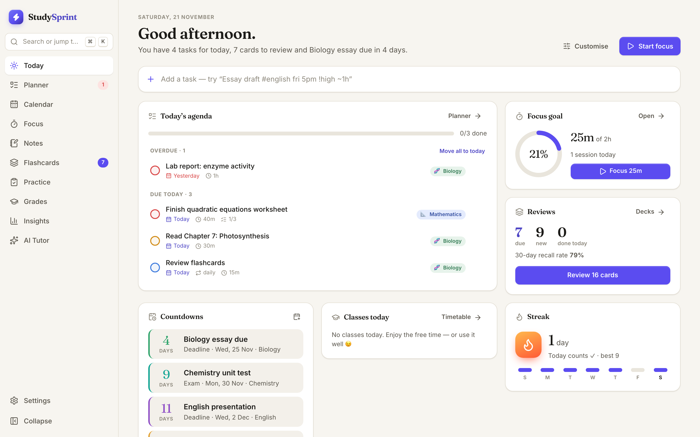
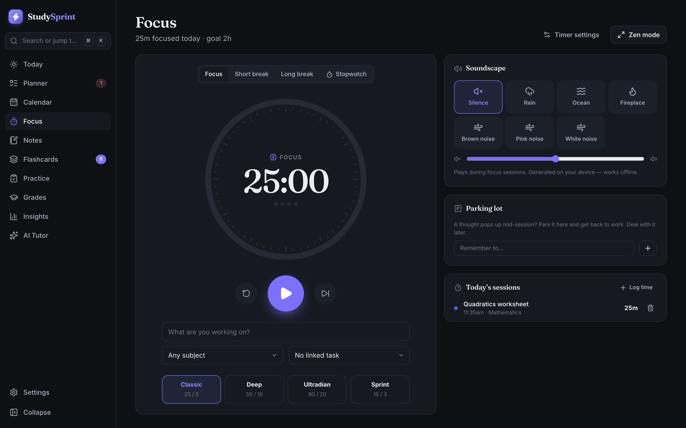
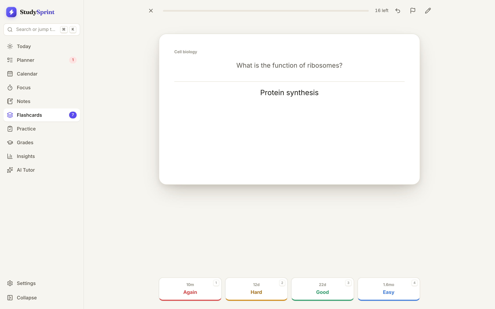
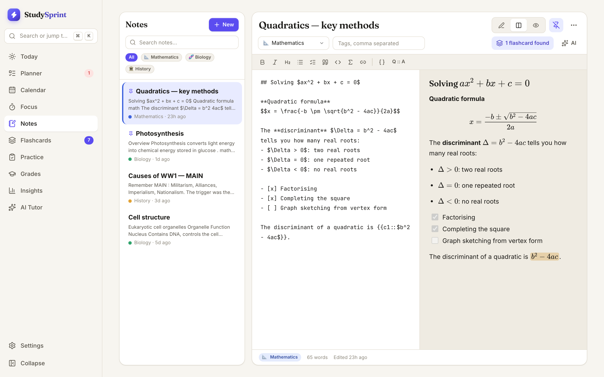
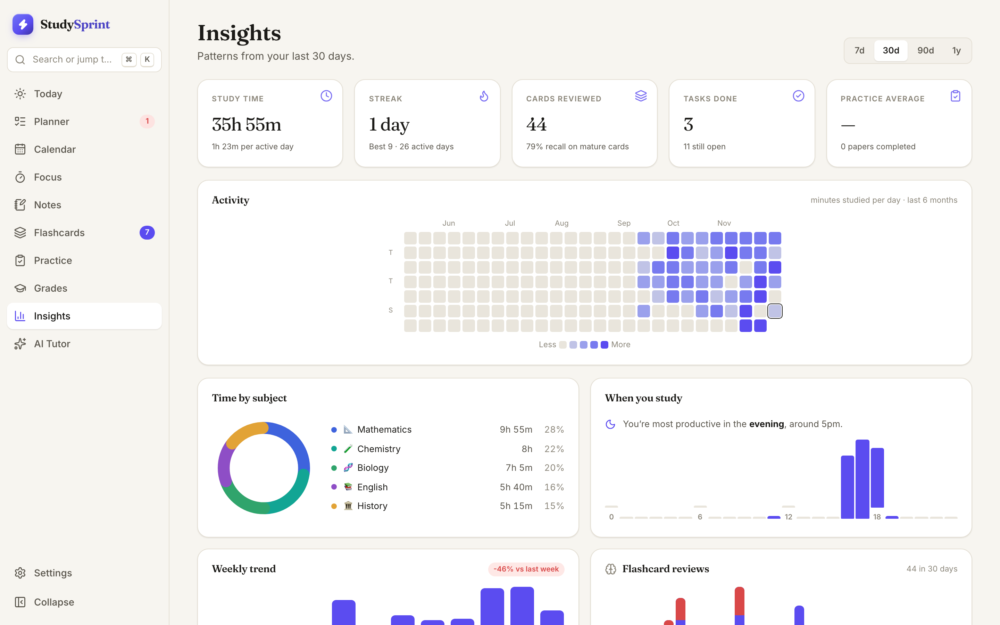
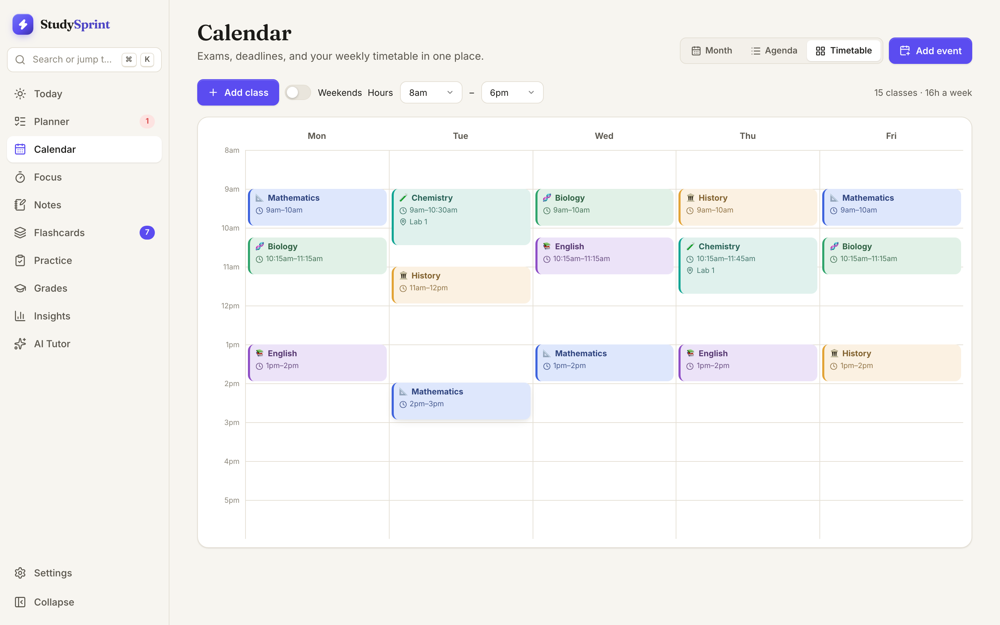
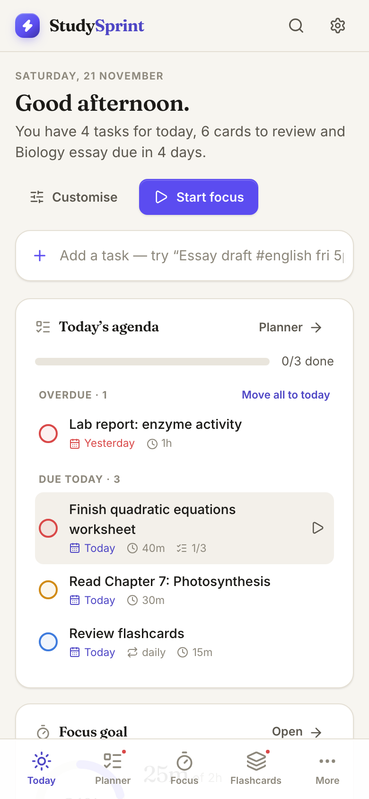
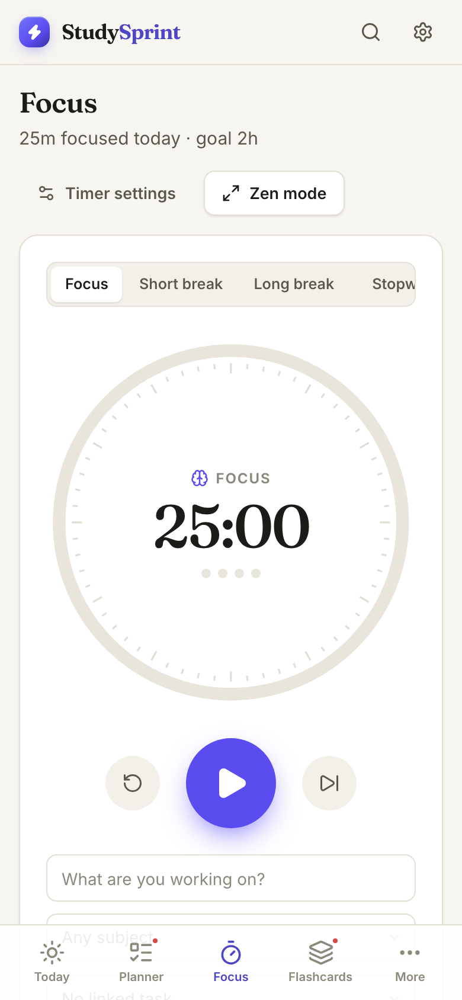

# StudySprint

**Plan, focus, remember.** StudySprint is an all-in-one study app that lives on your device: a planner, timetable, focus timer, notes, spaced-repetition flashcards, mock exams, grade tracker, analytics and an optional AI tutor, all in one calm, customisable place.

**Try it:** https://nikhildoesntcommit.github.io/StudySprint/

No account, no server, no tracking. Everything is stored in your browser. It works offline and installs like an app (PWA).



<table>
  <tr>
    <td></td>
    <td></td>
  </tr>
  <tr>
    <td></td>
    <td></td>
  </tr>
  <tr>
    <td></td>
    <td align="center"> </td>
  </tr>
</table>

## What's inside

| Module | What it does |
|---|---|
| **Today** | A customisable dashboard: agenda, focus goal, reviews due, exam countdowns, today's classes, streak, weekly chart, grades, recent notes and study tips. Choose widgets and reorder them. |
| **Planner** | Tasks with subjects, priorities, checklists, estimates, tags and repeats. Shown as a list, a drag-and-drop board, or an urgent × important matrix. **Natural-language quick add**: `Essay draft #english fri 5pm !high ~1h every week`. |
| **Calendar** | Month and agenda views for exams, deadlines and events, plus a weekly **class timetable**. A **revision planner** spaces study sessions for each topic across the days before an exam. |
| **Focus** | Pomodoro, deep-work and custom timers with a stopwatch mode, generated ambient sound (rain, ocean, fireplace, brown, pink and white noise), linked tasks and subjects, a "parking lot" for distracting thoughts, zen mode and notifications. |
| **Notes** | Markdown with **LaTeX maths**, checklists, tables, `[[wiki links]]` and backlinks. Lines like `Term :: Definition` or `{{c1::cloze}}` become flashcards in one click. |
| **Flashcards** | **FSRS** spaced repetition (the modern successor to SM-2) with basic, reverse and cloze cards, interval previews, undo, flags, cram mode, card-state stats and a 14-day forecast. Import from spreadsheets, Quizlet or Anki text. Quiz yourself from any deck. |
| **Practice** | Timed **exam mode** or instant-feedback **practice mode**, with MCQ, multi-select, true/false, short-answer and self-marked written questions, negative marking, sections, hints, a calculator and a question map. Results break down by topic. An **error book** collects your mistakes so you can drill them or turn them into flashcards. Includes a paper builder and JSON import/export. |
| **Grades** | Weighted assessments per course, your current average, letter grade and GPA, and *what you need on the rest* to hit your target, with a what-if slider. |
| **Insights** | Study heatmap, time by subject, the hours you study best, weekly trend, flashcard recall and practice scores. |
| **AI Tutor** | Optional, powered by Claude using your own Anthropic API key. Chat in explain, Socratic, simple or exam-coach mode, and attach notes as context. Summarise notes, generate flashcards and generate practice quizzes. |

### Make it yours
- Themes: light, dark, midnight, sepia, high-contrast, or follow your system. Nine accent colours.
- Reading fonts: Inter, **Atkinson Hyperlegible**, **Lexend** and **OpenDyslexic**, all bundled so they work offline. Text size from 85% to 130%, compact or comfortable density, rounded or sharp corners, and a reduced-motion option.
- Turn off any module you don't use. Your subjects, colours, emojis and weekly goals colour-code everything.
- Keyboard-first: <kbd>⌘/Ctrl K</kbd> opens the command palette and search, <kbd>N</kbd> creates a new task, <kbd>F</kbd> starts or pauses the timer, <kbd>R</kbd> reviews cards, <kbd>1–9</kbd> switches module, and <kbd>?</kbd> lists every shortcut.

## Your data
- Data is stored in IndexedDB in your browser. Use **Settings → Data** to download a backup, restore it, or merge it on another device.
- Data from the previous StudySprint (v3) is detected automatically, and its tasks can be imported.
- Your AI key is kept only in your browser, is left out of backups by default, and is sent only to `api.anthropic.com`.

## Exam file format
Practice papers use a portable JSON format (compatible with the earlier Test Book app). See [`docs/exam-file-format.md`](docs/exam-file-format.md), or download a template from **Practice → Import**.

## Development

```bash
npm install
npm run dev        # local dev server
npm test           # unit tests (scheduler, quick-add parser, exam engine, streaks)
npm run build      # type-check and production build to dist/
```

Built with React, TypeScript and Vite. State is kept with Zustand and persisted to IndexedDB. Markdown is rendered with marked, DOMPurify and KaTeX, and icons come from lucide. Each push to `main` is tested, built and deployed to GitHub Pages by `.github/workflows/main.yml`.

```
src/
  lib/         scheduling (FSRS), quick-add parser, exam engine, markdown, audio, stats, AI, backup
  store/       persisted app store, focus-timer store, UI store, defaults
  components/  app shell, command palette, UI primitives, task and event editors
  pages/       one file per module
  styles/      design tokens, components, page styles
public/        service worker, manifest, icons, sample exam papers
```

## History

StudySprint began as a School AI Club project (v1–v3), with a separate offline exam tool called Test Book. Version 4 is a ground-up rebuild that brings both together into one app.
